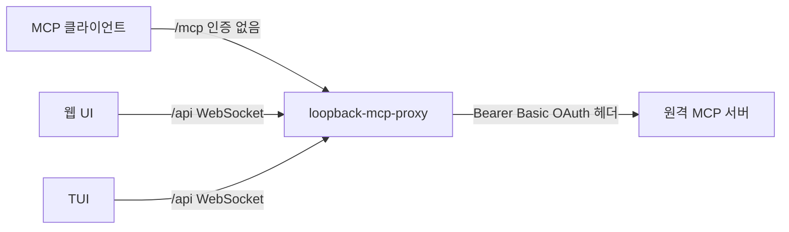
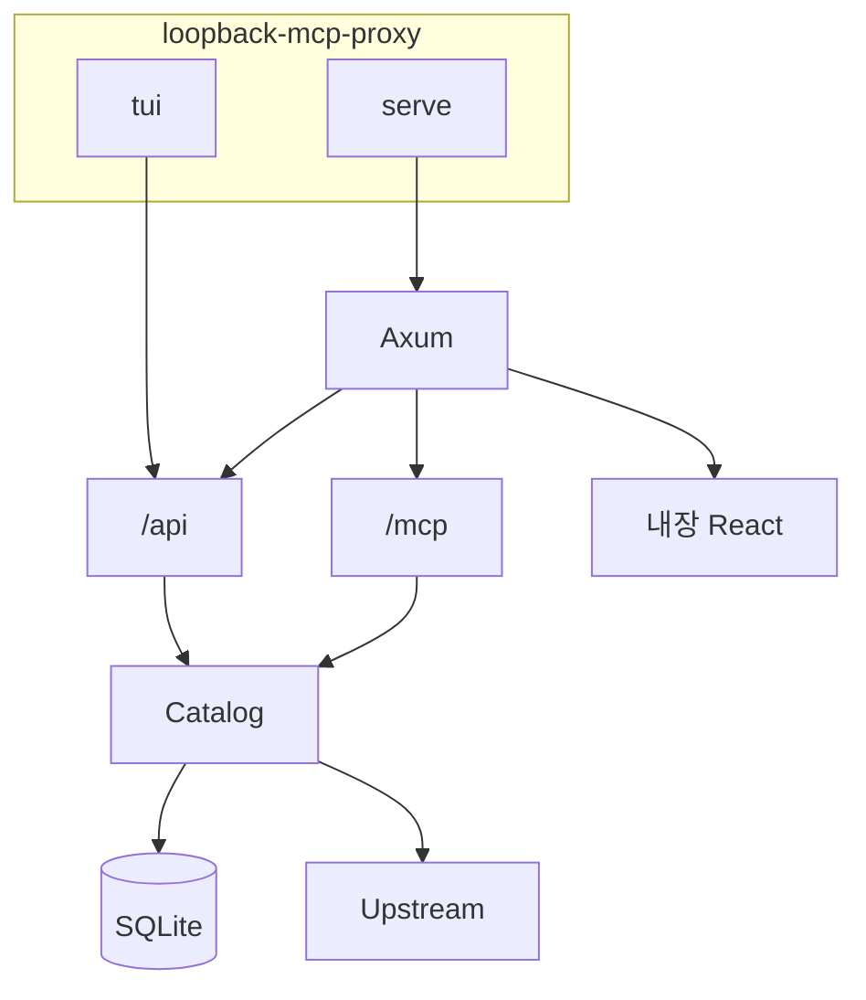
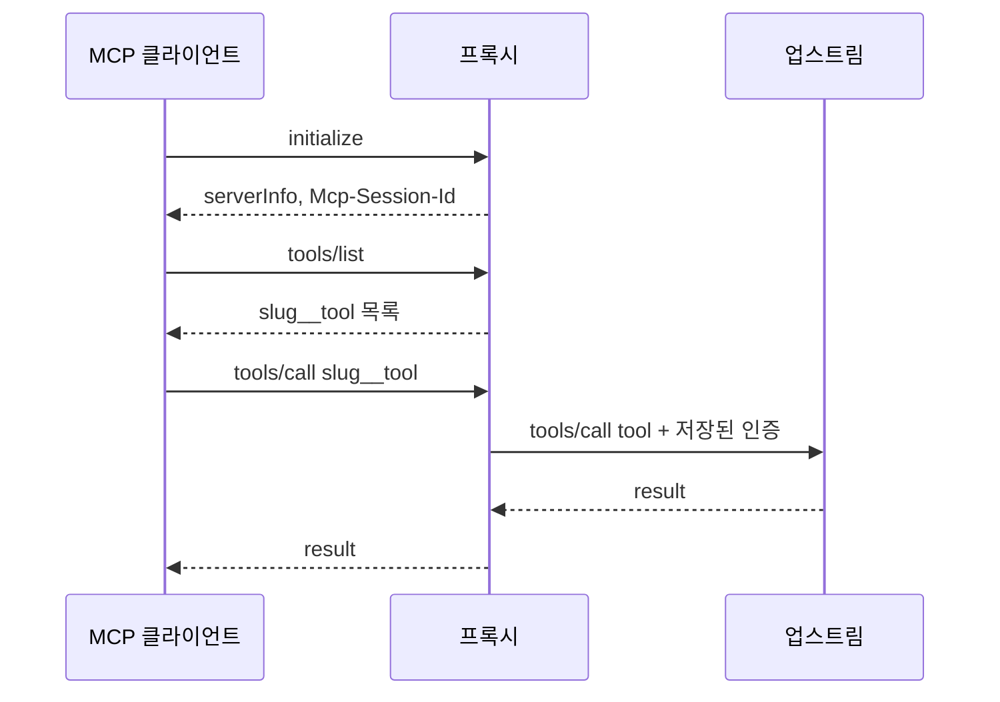
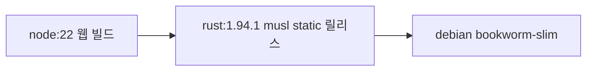

# 설계

`docs/requirements.md`를 만족하는 현재 구현의 구조다. 단일 Rust 바이너리 `loopback-mcp-proxy`가 MCP 프록시, 관리 API, 웹 UI를 같이 제공한다. TUI는 같은 바이너리의 서브커맨드이며 관리 API의 클라이언트다.

## 신뢰 경계



로컬 클라이언트와 관리 화면은 루프백을 신뢰 경계로 본다. 업스트림 자격 증명은 프록시 밖으로 나가지 않는다. 관리 API 응답은 토큰과 비밀번호를 빼고, 설정 여부만 돌려준다.

호스트에서 기본 수신 주소는 `127.0.0.1:8080`이다. 루프백이 아닌 주소는 `ALLOW_NON_LOOPBACK=1`이 있을 때만 허용한다. Docker Compose는 컨테이너 안 `0.0.0.0:8080`을 호스트 `127.0.0.1:8080`으로만 게시한다.

`ADMIN_TOKEN`이 있으면 `/api`와 관리 WebSocket만 Bearer 토큰을 요구한다. `/mcp`와 OAuth 콜백은 열려 있다. 콜백은 추측하기 어려운 `state`로 거래를 찾는다.

## 프로세스



`serve`가 리스너를 연다. `tui`는 이미 떠 있는 서버의 `PROXY_URL`(기본 `http://127.0.0.1:8080`)에 붙는다. 컨테이너에서는 `docker exec -it <container> loopback-mcp-proxy tui`로 실행한다.

## 모듈

| 모듈 | 책임 |
| --- | --- |
| `config` | `BIND`, `DATA_DIR`, `PUBLIC_BASE_URL`, `ADMIN_TOKEN`, `ALLOW_NON_LOOPBACK` |
| `model` | 서버, 인증, 공개 뷰, slug 규칙, 시크릿 병합 |
| `crypto` / `store` | AES-256-GCM과 SQLite |
| `auth` | 인증 헤더, 토큰 발급과 갱신, OAuth discovery, PKCE |
| `upstream` | Streamable HTTP와 SSE 클라이언트 |
| `catalog` | 연결 상태, tool 목록, 호출, 재시도 |
| `mcp` | 다운스트림 JSON-RPC |
| `http` | 관리 API, WebSocket, OAuth 콜백, MCP 라우트 |
| `web` | `web/dist`를 바이너리에 포함해 정적 파일로 제공 |
| `tui` | ratatui 관리 화면 |

웹 소스는 `web/`의 Vite + React다. 빌드 결과는 `rust-embed`로 바이너리에 들어간다.

## 데이터

SQLite 파일은 `{DATA_DIR}/proxy.db`다.

- `servers`: id, name, slug, url, transport, enabled, `auth_blob`, 시각
- `oauth_tx`: authorization code 거래. `state`, PKCE verifier, redirect URI, 생성 시각. 유효 시간은 15분이다.

`auth_blob`은 인증 설정 JSON을 AES-256-GCM으로 암호화한 값이다. 키는 `PROXY_DATA_KEY`(표준 Base64 32바이트) 또는 `{DATA_DIR}/master.key`다. 키 파일과 DB 파일 권한은 `0600`이다.

slug는 1자 이상 48자 이하의 소문자, 숫자, 하이픈이다. 밑줄은 허용하지 않는다. tool 이름은 `{slug}__{tool}`이라서, 첫 `__` 앞이 slug다. 업스트림 tool 이름 안의 `__`는 그대로 남는다.

편집 시 비밀 값이 비어 있으면 기존 값을 유지한다. 단, 인증 종류가 바뀌거나 업스트림 URL의 origin(scheme, host, port)이 바뀌면 자격 증명 유출을 막기 위해 이전 비밀을 재사용하지 않는다.

런타임 상태 `ConnState`는 메모리에만 있다. `idle`, `disabled`, `connecting`, `connected`, `authRequired`, `error`.

## 다운스트림 MCP

`POST /mcp`는 연결된 모든 업스트림 tool을 합친다. `POST /mcp/{slug}`는 그 서버의 원래 tool 이름을 쓴다.



지원 메서드는 `initialize`, `ping`, `tools/list`, `tools/call`, `resources/list`, `resources/templates/list`, `prompts/list`, `logging/setLevel`이다. 리소스와 프롬프트는 빈 목록이다. `initialize` 이후 요청은 같은 엔드포인트 스코프의 `mcp-session-id`가 필요하다. `/mcp/{slug}`는 해당 업스트림의 `serverInfo`와 원래 tool 이름을 반환한다. `GET /mcp`와 `GET /mcp/{slug}`는 서버 알림용 SSE이며, 해당 스코프의 카탈로그가 바뀌면 `notifications/tools/list_changed`를 보낸다. `DELETE /mcp`는 세션을 지운다.

연결되지 않은 업스트림의 tool은 목록에 넣지 않는다.

## 업스트림 연결

전송은 `streamable-http`와 `sse`다.

- Streamable HTTP는 MCP 엔드포인트에 JSON-RPC POST를 보낸다. `Accept`는 `application/json, text/event-stream`이다. 세션 헤더는 `mcp-session-id`다. 프로토콜은 `2025-06-18`, `2025-03-26`, `2024-11-05` 순으로 맞춘다.
- SSE는 `GET`으로 스트림을 열고 `endpoint` 이벤트의 주소로 POST한다. 응답은 스트림에서 id로 맞춘다.

`initialize` 다음에 `notifications/initialized`를 보낸다. `tools/list`는 `nextCursor`가 없을 때까지 따라간다.

카탈로그는 5초마다 점검한다. 오류는 2초에서 시작해 최대 60초까지 간격을 늘려 재연결한다. `authRequired`는 자동 재시도를 하지 않는다. 연결된 서버의 tool 목록은 60초마다 다시 읽는다.

## 인증

```mermaid
flowchart TD
  call[업스트림 호출 직전]
  call --> kind{인증 종류}
  kind -->|none| send[요청]
  kind -->|bearer 또는 basic 또는 headers| send
  kind -->|oauth2| fresh{만료 60초 이내 또는 토큰 없음}
  fresh -->|아니오| send
  fresh -->|authorization code| refresh[refresh_token]
  fresh -->|client credentials| cc[client_credentials]
  refresh --> send
  cc --> send
  send --> denied{401 또는 403}
  denied -->|예| once[한 번 더 갱신 후 재시도]
  denied -->|아니오| done[결과]
```

- Bearer는 `Authorization: Bearer`다.
- Basic은 `Authorization: Basic base64(user:pass)`다. Realm은 요청에 실리지 않고, 업스트림 `WWW-Authenticate`의 realm과 비교해 오류 메시지에 남긴다.
- Headers는 지정한 헤더를 보낸다. 주 인증이 `Authorization`을 만들면 그 값이 추가 헤더보다 우선한다.
- OAuth authorization code는 PKCE S256이다. 시작 시 discovery로 authorize, token, registration 엔드포인트를 채울 수 있다. client id가 없고 registration 엔드포인트가 있으면 동적 등록을 시도한다. 브라우저 승인 후 `GET /oauth/callback`이 code를 교환하고 서버를 다시 연결한다.
- client credentials는 토큰이 없거나 만료 60초 안이면 token 엔드포인트를 다시 호출한다.
- 토큰 요청이 401이면 본문 시크릿 방식 다음에 HTTP Basic 클라이언트 인증을 한 번 더 시도한다.
- 갱신된 토큰은 암호화된 `auth_blob`에 다시 저장한다.

Discovery는 인증 없는 `initialize`를 보내고, 401의 `resource_metadata`와 protected resource metadata, authorization server metadata를 읽는다.

## 실시간 반영

관리 변경과 연결 상태 변경은 `broadcast`로 `upsert`, `remove`, `ping`을 보낸다. WebSocket `/api/ws`는 접속 직후 `snapshot`을 보내고 이후 이벤트를 전달한다. 웹과 TUI가 이 소켓을 구독한다. 이벤트 유실에 대비해 웹은 접속 시 `GET /api/servers`도 읽는다.

## 관리 API

| 메서드 | 경로 | 역할 |
| --- | --- | --- |
| GET | `/api/meta` | 버전, MCP 주소, 관리 토큰 필요 여부 |
| GET/POST | `/api/servers` | 목록, 생성 후 연결 |
| GET/PUT/DELETE | `/api/servers/{id}` | 조회, 수정 후 재연결, 삭제 |
| POST | `/api/probe` | 저장하지 않는 연결 시험. `serverId`가 있으면 빈 비밀은 저장된 값과 합친다 |
| GET | `/api/discover?url=` | OAuth 메타데이터 탐색 |
| POST | `/api/servers/{id}/reconnect` | 재연결 |
| POST | `/api/servers/{id}/oauth/start` | 브라우저 승인 URL |
| POST | `/api/servers/{id}/tools/call` | tool 실행 |
| GET | `/api/ws` | 실시간 이벤트 |
| GET | `/oauth/callback` | authorization code 교환 |

생성과 수정은 검증 후 카탈로그 연결이 끝난 뷰를 반환한다. 연결 실패도 서버는 저장되고, `state`와 `message`로 이유를 보여 준다.

## 웹

Hash 라우터를 쓴다. 화면은 목록, 추가 마법사, 상세, 편집이다.

마법사 단계는 식별 정보, 인증, 연결이다. 연결 단계에서 `/api/probe`를 호출한다. OAuth authorization code로 저장하면 `/oauth/start`로 브라우저를 이동시킨다. 승인 뒤 콜백은 `#/servers/{id}`로 돌아온다.

tool 화면은 `inputSchema`의 단순 속성(문자열, 숫자, 정수, 불리언, enum)을 폼으로 만들고, 그 외는 JSON 입력으로 둔다. 실행은 `/api/servers/{id}/tools/call`이다.

## TUI

목록과 상세를 한 화면에 두고, 추가와 편집은 폼으로 전환한다. 인증 종류에 따라 입력 칸이 바뀐다. `Ctrl-T`는 probe, `Ctrl-S`는 저장이다. 저장과 재연결, 삭제는 관리 API를 호출하고, 목록 갱신은 WebSocket 이벤트로 받는다.

## 컨테이너



릴리스 바이너리의 플랫폼 순서, musl 정적 링크, 산출물 경로는 `docs/platforms.md`에 정리한다. 이미지는 그 문서의 Linux 정적 바이너리와 CA 인증서만 담는다. `DATA_DIR=/data`가 볼륨이다. 진입점은 `loopback-mcp-proxy serve`다.

## 환경 변수

| 변수 | 기본값 | 의미 |
| --- | --- | --- |
| `BIND` | `127.0.0.1:8080` | 수신 주소 |
| `ALLOW_NON_LOOPBACK` | 없음 | 루프백 밖 수신 허용 |
| `DATA_DIR` | `./data` | DB와 키 |
| `PUBLIC_BASE_URL` | `http://127.0.0.1:<port>` | OAuth redirect의 기준 주소 |
| `ADMIN_TOKEN` | 없음 | 관리 API 보호 |
| `PROXY_DATA_KEY` | 없음 | 자격 증명 암호화 키 |
| `PROXY_URL` | `http://127.0.0.1:8080` | TUI가 붙는 서버 |
