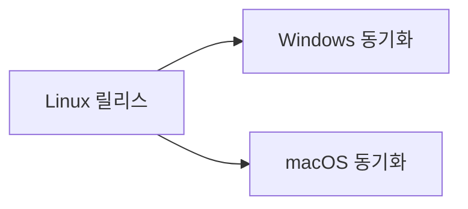
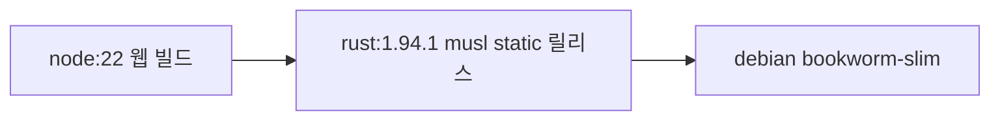

# 플랫폼과 릴리스

Docker로 배포하되, 같은 릴리스 바이너리를 컨테이너 밖에서도 공유 라이브러리 없이 실행할 수 있게 한다. 구현 순서는 Linux가 먼저고, Windows와 macOS는 그 리눅스 릴리스를 기준으로 나중에 맞춘다.

## 우선순위

1. Linux `amd64`와 `arm64`가 1순위다. 릴리스 레시피는 `scripts/release-musl.sh` 하나다.
2. Windows와 macOS는 별도 설계로 먼저 만들지 않는다. 리눅스 릴리스의 타깃 구성과 산출물 경로를 그대로 맞추는 후속 구현이다.
3. 지금은 Linux만 빌드한다. `darwin`과 `windows` 타깃은 Makefile에 없다.

## Linux 릴리스

릴리스는 glibc 동적 링크를 쓰지 않는다. Rust 타깃은 musl이고, `.cargo/config.toml`이 `crt-static`을 켠다. 그래서 바이너리는 공유 libc와 libgcc 없이 실행된다.

| 아키텍처 | Rust 타깃 | 산출물 |
| --- | --- | --- |
| amd64 | `x86_64-unknown-linux-musl` | `build/linux-amd64/release/loopback-mcp-proxy` |
| arm64 | `aarch64-unknown-linux-musl` | `build/linux-arm64/release/loopback-mcp-proxy` |

| 명령 | 동작 |
| --- | --- |
| `make build`, `make linux` | 웹 자산을 만든 뒤 이 호스트의 Linux 릴리스를 빌드한다 |
| `make linux-amd64` | amd64 musl 릴리스 |
| `make linux-arm64` | arm64 musl 릴리스 |

번들 SQLite는 C로 컴파일한다. 네이티브 빌드의 컴파일러는 `musl-gcc`다. Debian과 Ubuntu에서는 `musl-tools` 패키지가 제공한다. 호스트와 다른 아키텍처는 `<rust-arch>-linux-musl-gcc`를 찾는다. `amd64`로 다른 머신용 arm64를 빌드할 때는 `aarch64-linux-musl-gcc`, 그 반대는 `x86_64-linux-musl-gcc`다. 다른 경로의 컴파일러는 `MUSL_CC`로 지정한다. 컴파일러가 없으면 스크립트는 그 이름을 알리고 멈춘다.

`cargo test`와 `cargo run`은 이 릴리스 타깃을 쓰지 않는다. 호스트 툴체인으로 개발 바이너리를 만든다.

## 컨테이너

이미지는 위에서 만든 정적 바이너리를 담는다. 런타임 베이스가 Debian이어도 바이너리 자체는 musl 정적 링크다.

빌드 스테이지는 `musl-tools`를 설치하고 `scripts/release-musl.sh`를 실행한 뒤 `build/linux-*/release/loopback-mcp-proxy`를 복사한다. 최종 이미지는 그 파일과 CA 인증서를 담는다. 진입점은 `loopback-mcp-proxy serve`다.

## 이후 Windows와 macOS

리눅스 릴리스가 기준이다. 맞출 때 지키는 구성은 다음이다.

- 산출물 경로는 `build/<os>-<arch>/release/loopback-mcp-proxy`다. Windows 파일명만 `.exe`를 붙인다.
- 아키텍처 이름은 `amd64`, `arm64`를 유지한다.
- 릴리스는 가능한 한 공유 라이브러리 없이 단독 실행되게 링크한다. Linux에서 그 방법이 musl과 `crt-static`이다.
- 개발용 `cargo test`와 `cargo run`은 호스트 툴체인에 둔다.

이 구성이 정해지기 전에 Windows나 macOS용 빌드 규칙을 따로 만들지 않는다.
